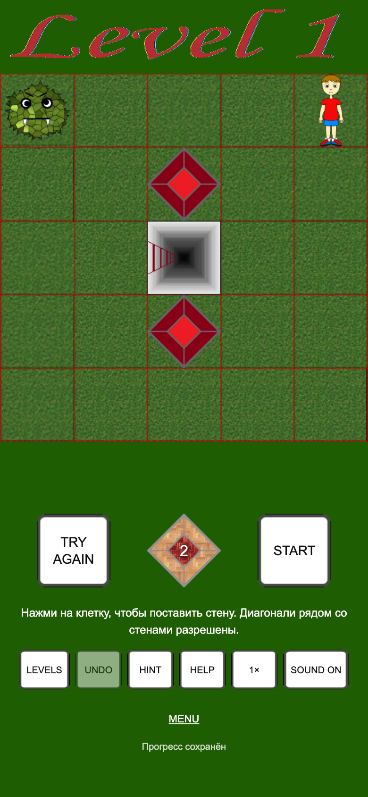

# Поймай монстра · Catch the Monster

Головоломка для браузера и Android с правилами и оформлением исходной игры. Монстр выбирает кратчайший путь к герою. Расставляй стены, чтобы этот путь прошёл через яму.

Переработка Android-прототипа 2017 года: один игровой движок, 24 проверенных уровня, порталы, звёзды, подсказки и локальное сохранение. Исходные изображения, зелёный фон, меню, выбор уровней и победа с решёткой и YOU WIN восстановлены из ресурсов последней полной Android-версии. Без рекламы, регистрации, сервера и зависимостей времени выполнения.



## Быстрый запуск в браузере

Нужен Node.js 20 или новее. Установка npm-пакетов не требуется.

```sh
npm start
```

Открыть **http://127.0.0.1:4173**. Альтернатива: `node scripts/serve.mjs`.

```sh
npm test          # Правила, минимальные решения всех уровней, сохранения
npm run check    # Проверка синтаксиса
npm run build    # Готовая статическая игра в dist/
node scripts/serve.mjs --dist
```

Папку `dist/` можно разместить на любом статическом HTTPS-хостинге, в том числе в подпапке. Для локального запуска используйте HTTP-сервер, а не `file://`: игра использует JavaScript-модули. После первой полной загрузки service worker сохраняет игру для офлайн-запуска. Сборка автоматически меняет ключ кэша при изменениях исходников. В режиме разработки файлы сначала загружаются с сервера.

## Android

Нужны JDK 17, Android SDK Platform 36 и Build Tools 35.0.0. Android Studio умеет устанавливать эти компоненты. Укажите SDK в `ANDROID_HOME` или `android/local.properties`.

```sh
cd android
./gradlew :app:assembleDebug :app:lintDebug
```

APK: **`android/app/build/outputs/apk/debug/app-debug.apk`**. Windows: `gradlew.bat`.

Приложение поддерживает Android 8.0+ и автоматически включает текущую папку `web/`. Игра работает офлайн сразу после установки. Это Android-приложение с локальным WebView-интерфейсом; правила, графика и уровни общие с браузерной версией. Сетевых разрешений и JavaScript-моста к нативным API нет.

Подробности сборки, установки, подписи и жизненного цикла — в [android/README.md](android/README.md). Debug APK предназначен для проверки. Для публикации и обновления установленной старой игры нужен собственный ключ подписи; ключи не хранятся в репозитории.

## Правила

1. Нажми на свободную клетку, чтобы поставить стену. Повторное нажатие возвращает стену в запас. Камни и персонажей перемещать нельзя.
2. Нажми START. Монстр движется по прямой и по диагонали; каждый шаг стоит одинаково. Ход разрешён, если свободна клетка назначения. По диагонали рядом со стенами и камнями, в том числе между двумя препятствиями, ходить можно.
3. Монстр предпочитает кратчайший путь. При равной длине выбирает маршрут без ловушки. Нужно сделать путь через ловушку **строго короче** обхода.
4. Если герой полностью недоступен, попытка не запускается. Запереть монстра — не значит поймать его.
5. В третьей главе появляются парные порталы. Вход стоит один шаг, перемещение к парному выходу происходит сразу. Повторного переноса с выхода не происходит.

Три звезды даются за решение с минимальным числом стен без подсказок. Одна лишняя стена — две звезды; больше — одна. Подсказка ограничивает результат двумя звёздами в текущей попытке. После победы REPLAY начинает новую самостоятельную попытку, NEXT открывает следующий уровень. Лучший результат всегда сохраняется.

Нет таймера и лимита попыток. Прогресс, черновик расстановки, звук и скорость сохраняются на устройстве. Старая вкладка не может уменьшить уже заработанные звёзды. Очистка данных браузера или удаление Android-приложения удаляет локальные сохранения; синхронизации между устройствами нет. Старые Android-сохранения SharedPreferences не мигрируются: новая кампания начинается с первого уровня.

Обновление до исходных правил сохраняет звёзды и открытые уровни версии 2.0. Черновик старой попытки сбрасывается один раз: изменились диагонали и некоторые поля. Новые расстановки снова сохраняются как обычно.

Клавиатура: стрелки выбирают свободную клетку, Enter/пробел нажимают выделенную кнопку, Ctrl/⌘+Z отменяет ход, R очищает поле. Пробел вне кнопки запускает/приостанавливает монстра. При сворачивании игра ставится на паузу. Android Back закрывает помощь, приостанавливает движение и возвращает на предыдущий экран. EXIT закрывает Android-приложение; в браузере показывает экран выхода.

## Устройство проекта

```text
web/                     Общая игра: интерфейс, звук и офлайн-кэш
  assets/original/       Неизменённые PNG/JPEG из исходной Android-игры
  engine.js              Чистые правила и детерминированный поиск пути
  levels.js              24 уровня и проверенные минимальные решения
  app.js                 Интерфейс, анимация, управление и переходы
  storage.js             Валидация и объединение локального прогресса
android/                 Android-контейнер, Gradle wrapper и ресурсы
tests/                   Проверки правил, сохранений и браузерных сценариев
scripts/                 Локальный сервер и статическая сборка
docs/BRANCH_AUDIT.md      Исследование всех четырёх исходных веток
docs/DESIGN_RESTORATION.md Источники графики и композиция исходных экранов
docs/VERIFICATION.md      Результаты проверки браузера и Android
legacy/                  Сохранённые исходники и ресурсы прототипа
```

Движок отделён от DOM. BFS рассматривает достижение героя с посещением ловушки и без неё, выбирает оптимальный маршрут и обрывает анимационный путь на ловушке. Направления обхода фиксированы; одинаковая расстановка всегда даёт одинаковый результат. Недостижимые цели и ошибочные расстановки возвращают безопасный результат blocked.

## Проверка и CI

46 модульных тестов перебирают 113 983 непустых размещения с меньшим числом стен, проверяют пустое поле каждого уровня и подтверждают минимальность решений. Отдельный независимый поиск проверяет все 32 256 расположений монстра, героя, ямы и препятствий на поле 3 × 3. Проверяются свободные диагонали, обход ямы при равенстве путей, порталы, непроходимые поля, повреждённые/недоступные сохранения, миграция и прогресс между вкладками.

Регрессия со скриншота: монстр A3, герой E3, яма C3, стены C2 и C4. Безопасный путь A3 → B2 → C1 → D2 → E3 занимает четыре хода, столько же, сколько прямой путь через яму; монстр выбирает обход.

После восстановления правил пересчитаны решения и подсказки всех 24 уровней. Запас стен увеличен в уровнях 3, 4 и 19. В уровне 10 убран камень D4, чтобы пустое поле не давало автоматическую победу. В уровне 21 добавлены камни F5 и G5, чтобы минимальное решение использовало порталы. Во всех семи уровнях с порталами минимальное решение проходит через оба портала.

Браузерные проверки находятся в `tests/ui-smoke.mjs`. Для них нужен Playwright с Chromium; параметры запуска описаны в начале файла. Основная игра и npm test не требуют Playwright. Браузерный сценарий проходит все 24 уровня настоящими нажатиями, проверяет мобильный экран, проигрыш, подсказки, управление, восстановление и офлайн-загрузку.

GitHub Actions запускает модульные тесты, собирает браузерную папку и Android APK, выполняет Android lint и сохраняет артефакты сборки. Публикация сайта и выпуск в магазин автоматически не выполняются.

## Исходные ветки

Изучены и сохранены master, Anton_branch, Evgeny_branch, Gregory_branch. Основная идея и правила выбора пути происходят из оригинального проекта; парные порталы реализуют идею из его README. Девять уровней из Gregory_branch и ранние варианты документированы в [аудите](docs/BRANCH_AUDIT.md).

Кампания проверена под исходные правила свободных диагоналей и предпочтения безопасного пути при равенстве. Исходный код, презентации и изображения сохранены в legacy/2017/, а Git-история веток не переписывалась. Все 24 используемых изображения скопированы без изменений из legacy/2017/main/res/drawable/. Происхождение ресурсов и восстановленные экраны описаны в [документе об оформлении](docs/DESIGN_RESTORATION.md). Заголовки уровней 9–24, порталы и рабочая помощь дополняют исходную игру в её стиле: готовых ресурсов для них в старых ветках нет. Синтезируемый звук и графика не требуют загрузки внешних ресурсов.
